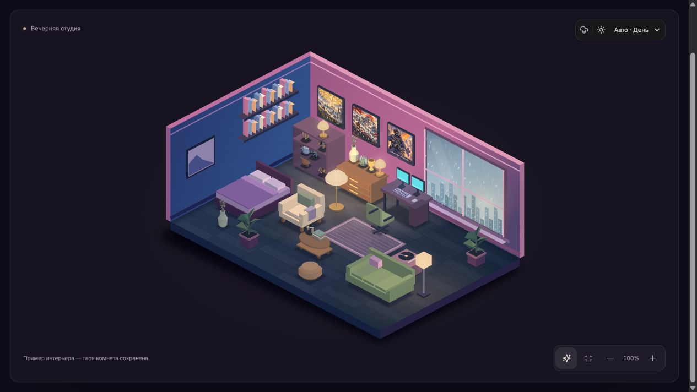

<div align="center">

# TinyMe

### Маленькое пространство, которое становится твоим.

Пиксельная комната, любимая музыка и спокойный ритм.<br>
Обустраивай свой уголок — от первого растения до последней детали.

[](package.json)
[](package.json)
[](tsconfig.json)
[](engine/)
[](#статус-и-направление)

**[Возможности](#возможности)** · **[Запуск](#быстрый-старт)** · **[Архитектура](#как-устроен-проект)** · **[ТЗ 1.4](docs/tz/TZ.md)**

<br>



<sub>Пример интерьера MyRoom — основы интерактивной комнаты TinyMe.</sub>

</div>

---

## Свой уголок внутри дня

**TinyMe** объединяет собственное пиксельное интро и интерактивную комнату **MyRoom**. На главной — приглашение войти в маленькое внутреннее пространство. В комнате — мебель, музыка, житель и атмосфера, которую можно настроить под себя.

Передвинь кресло, поставь растение на полку, включи дождь и любимый плейлист. Таймер начисляет **1 монету за полную минуту учтённого времени**, без суточного лимита; монеты можно потратить на предметы для комнаты.

## Возможности

| Пространство | Атмосфера | Музыка |
| :--- | :--- | :--- |
| Изометрическая комната и редактор мебели | День, вечер, ночь и автоматический свет | Загрузка собственных MP3 и WAV |
| Перемещение, поворот и размещение декора на поверхностях | Времена года, дождь, гроза и снег | Музыкальная коллекция и плейлисты |
| Цвета стен, пола и предметов | Гирлянды, подсветка и звуки погоды | Перемотка, громкость, shuffle и repeat |
| Магазин, инвентарь и коллекции предметов | Готовые пресеты и ручная настройка | История и статистика прослушиваний |

- **Житель комнаты.** Самостоятельные занятия, выбор внешности, одежды и аксессуаров.
- **Живые детали.** Часы, освещение и музыкальный эквалайзер дополняют сцену.
- **Режим отдыха.** Комната и компактный плеер остаются в центре внимания.
- **Сохранение.** Локальный гостевой режим и отдельное облачное состояние после входа.

Наличие этих модулей подтверждено исходниками. Работа облака зависит от настройки собственного окружения.

## Быстрый старт

Для разработки рекомендуется **Node.js 24** и npm.

```sh
git clone --branch main https://github.com/yessensiv/TinyMe.git
cd TinyMe
npm ci
npm run dev -- --port 3100
```

Открой **[http://127.0.0.1:3100](http://127.0.0.1:3100)**.

| Адрес | Что открывается |
| :--- | :--- |
| `/` | Интро TinyMe с переходом в комнату |
| `/intro` | Отдельный адрес того же интро |
| `/room` | Интерактивная комната MyRoom |

В комнате взаимодействуй со сценой, чтобы начать сессию. Затем открой редактор, выбери атмосферу или добавь музыку. Браузер может потребовать нажатие перед воспроизведением звука.

Без указания порта команда `npm run dev` использует порт `3000`.

<details>
<summary><b>Облачный режим и вход в аккаунт</b></summary>

Гостевая комната доступна без настройки Supabase.

Для облачного входа, сохранения и музыкальной библиотеки скопируй [.env.example](.env.example) в `.env.local` и заполни публичные параметры:

```dotenv
NEXT_PUBLIC_SUPABASE_URL=
NEXT_PUBLIC_SUPABASE_ANON_KEY=
```

Подготовь миграции, функцию музыкальной библиотеки и адреса возврата после входа по [руководству настройки](docs/SETUP.md). Для локального порта `3100` укажи соответствующие адреса в настройках авторизации.

После изменения переменных перезапусти приложение. Привилегированный серверный ключ должен оставаться на сервере.

</details>

## Личный прогресс

В меню комнаты появился раздел **«Мой рост»**: собственные навыки и цели, задачи, подтверждение выполнения, XP и уровни. Монеты за время учитываются отдельно. Житель реагирует существующим занятием выбранной категории.

Гостевой прогресс сохраняется на устройстве. Для аккаунтов подготовлен отдельный облачный backend, который ещё требуется применить к базе. Подробности и границы этапа — в [руководстве прогресса](docs/PROGRESS.md).

## Данные и сохранение

| Данные | Гостевой режим | Облачный аккаунт |
| :--- | :--- | :--- |
| Комната, предметы, монеты | localStorage | PostgreSQL |
| Загруженные аудиофайлы | IndexedDB | Приватный Supabase Storage |
| Плейлисты | Браузер | PostgreSQL |
| Музыкальная статистика и настройки плеера | Браузер | Браузер |

Гостевой прогресс **не переносится в аккаунт автоматически**. Локальные данные привязаны к браузеру и адресу сайта.

Учёт времени и фоновое воспроизведение зависят от работы браузера. Сон устройства и длительные неподтверждённые интервалы ограничивают начисления. Подробности и ограничения облачной музыки описаны в [SETUP.md](docs/SETUP.md).

## Как устроен проект

Исходники расположены в корне репозитория, без промежуточной папки `src/`.

| Каталог | Ответственность |
| :--- | :--- |
| [app/](app/) | Маршруты App Router, общий layout и стили |
| [features/intro/](features/intro/) | Пиксельное интро и переход в комнату |
| [components/](components/) | Комната, редактор, плеер, профиль и панели |
| [domain/](domain/) | Каталог, экономика, размещение, внешность и поведение жителя |
| [engine/](engine/) | Изометрия, графика, освещение и отрисовка |
| [lib/](lib/) | Состояние, сохранение, аудио и интеграции |
| [public/](public/) | Иллюстрации и аудиоресурсы |
| [supabase/](supabase/) | SQL-миграции и облачные функции |
| [tests/](tests/) | TypeScript-тесты и отдельные SQL-сценарии |
| [docs/](docs/) | ТЗ, настройка и история разработки |

**Стек:** Next.js 16 · React 19 · TypeScript · Tailwind CSS 4 · PixiJS 8 · Lucide · Web Audio API · Supabase.

Комната использует 2.5D-изометрию. Правила размещения и экономики вынесены в доменный слой, графика — в движок, а состояние и интеграции — в `lib/`.

### Команды разработки

| Команда | Назначение |
| :--- | :--- |
| `npm run dev -- --port 3100` | Сервер разработки на порту 3100 |
| `npm run typecheck` | Проверка типов TypeScript |
| `npm test` | TypeScript-тесты из `tests/*.test.ts` |
| `npm run lint` | Проверка ESLint |
| `npm run build` | Production-сборка |
| `npm start -- --port 3100` | Запуск готовой сборки |

В текущей конфигурации разработка и сборка используют **Webpack**. SQL-сценарии запускаются отдельно в тестовой базе и не входят в `npm test`.

## Статус и направление

**Проект в разработке.** Текущая реализация в `main` — интро TinyMe и функциональная основа комнаты MyRoom. [Техническое задание 1.4](docs/tz/TZ.md) задаёт дальнейшее развитие продукта.

| Есть в текущем коде | Предусмотрено ТЗ 1.4 |
| :--- | :--- |
| Комната, мебель, магазин и монеты | Произвольные навыки, цели и реальные задачи |
| Житель, внешность и отклик на завершение задачи | Новые анимации мастерства мини-тебя |
| Свои навыки, цели, задачи, XP и уровни | Предметные награды за достижения |
| Гостевое и облачное сохранение | Автоматический альбом роста и сравнение состояний |
| Пиксельное интро и вход в комнату | Граф прогресса и отдельный социальный этап |

Функции из правого столбца описывают направление разработки; их реализация не подтверждена текущим кодом. Полные требования и критерии приёмки находятся в ТЗ.

## Документация

| Документ | Содержание |
| :--- | :--- |
| [Техническое задание 1.4](docs/tz/TZ.md) | Концепция TinyMe, сценарии, приоритеты и критерии приёмки |
| [Возможности MyRoom](docs/myroom/README.md) | Подробности комнаты, музыки и атмосферы |
| [Мой рост](docs/PROGRESS.md) | Навыки, задачи, XP, сохранение и границы первого этапа |
| [Настройка окружения](docs/SETUP.md) | Облачное хранение, авторизация и ограничения |
| [Дизайн-система](UI-DESIGN-SYSTEM.md) | Визуальные правила интерфейса |
| [История разработки](docs/DEVELOPMENT-HISTORY.md) | Изменения основы MyRoom |
| [Происхождение постеров](public/art/posters/ART-NOTES.md) | Сведения об иллюстрациях |
| [Авторы звуков](public/audio/CREDITS.txt) | Источники и лицензии аудио |

---

<div align="center">

**Твоя комната. Твой ритм. Твоё маленькое пространство.**

[Посмотреть ТЗ](docs/tz/TZ.md) · [Изучить код](app/) · [Настроить проект](docs/SETUP.md)

</div>
